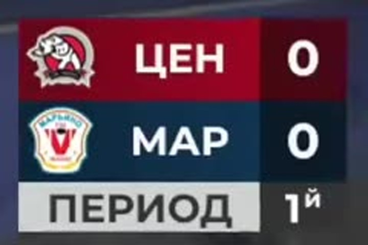
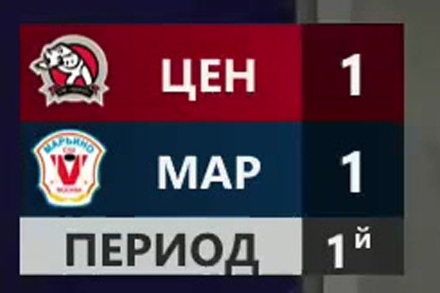
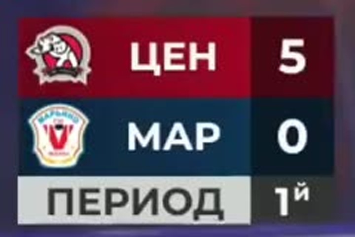
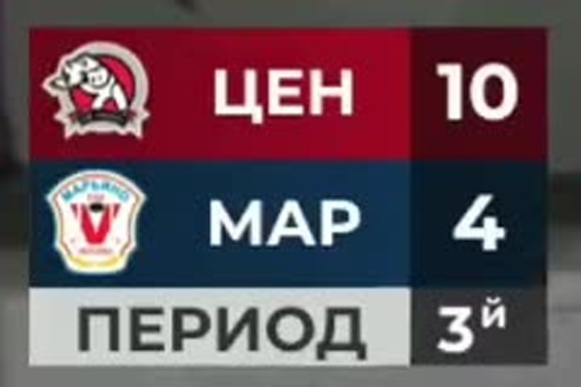
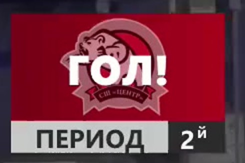
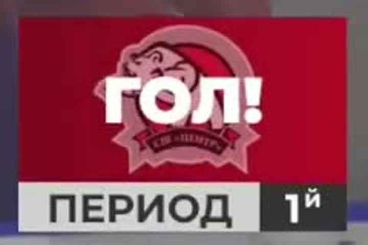

# Видеоразбор: «Центр» 2016 — «Марьино» 2016, 24.10.2026 (матч № 22440)

**Результат: 25:8** (8:2, 8:4, 9:2). Кубок г. Москвы, 2016 г.р. 26/27, формат 4×4,
группа В, 8 тур. Место: Москва, ЛЦ «Центральный», левое поле. Начало 11:00.
Судьи: Сыромятников М. Р., Франков А. П.
Протокол: [fhmoscow.com/game/22440](https://fhmoscow.com/game/22440).
Заявки на игру: [вкладка «Составы»](https://fhmoscow.com/game/22440?match-preview-tab=3).

Все таймкоды — ссылки на эпизод в источнике (формат `?t=`), время по видеозаписи.
**Обозначения:** хозяева в названии матча первые — **«Центр» играет в тёмной
(бордовой) форме, «Марьино» — в светлой (белой)**.
**Статус: частичный видеоразбор (версия 1).** Закрыто: все 33 гола и их время
(31 из 33), счёт по составам и периодам, заявки на игру, вратари по составам,
голевые серии, сверка сумм. Не закрыто: броски, сейвы, владение, время на льду,
звенья, штрафные броски, порядок авторов внутри периода — причины в разделах 9–11.

---

## 1. Как устроен этот матч

В формате 4×4 команда играет **двумя составами одновременно**: на каждой половине
площадки идёт своя игра, а протокол ФХМ показывает **сумму** двух игр.

Подтверждения:

- Две трансляции (Состав 1 и Состав 2) — это два разных счёта, а не половины
  одной записи: на табло видео 1 финально 10:4, на табло видео 2 — 15:4.
- Сумма финальных счётов: **10:4 + 15:4 = 25:8** — совпадает с протоколом.
- Сумма по периодам: **5:0 + 3:2 = 8:2**, **2:2 + 6:2 = 8:4**, **3:2 + 6:0 = 9:2**.
- Заявка на игру делит игроков на два состава, и каждый гол по номеру автора
  попадает в заявку своего состава (раздел 8.1).

## 2. Итоговые цифры

### 2.1 Составы и источники

| Состав | Видео | Счёт | 1-й период | 2-й период | 3-й период | Длительность |
|---|---|---|---|---|---|---|
| «Центр» Состав 1 | [видео 1](https://vkvideo.ru/video-48703984_456259531) | **10:4** | 5:0 | 2:2 | 3:2 | 1:37:06 |
| «Центр» Состав 2 | [видео 2](https://vkvideo.ru/video-48703984_456259532) | **15:4** | 3:2 | 6:2 | 6:0 | 1:32:42 |
| **Итого** | — | **25:8** | 8:2 | 8:4 | 9:2 | — |

### 2.2 Голы по периодам и командам

| Период | «Центр» | «Марьино» | Разница | Характер отрезка |
|---|---|---|---|---|
| 1-й | 8 | 2 | +6 «Центр» | быстрый отрыв, у Состава 1 — 5:0 |
| 2-й | 8 | 4 | +4 «Центр» | самый ровный отрезок «Марьино» |
| 3-й | 9 | 2 | +7 «Центр» | у Состава 2 — 6:0 |
| **Матч** | **25** | **8** | **+17** | победа хозяев |

### 2.3 Голы игроков (по протоколу ФХМ)

Голевые передачи в турнире ФХМ не ведутся, поэтому ассистов нет ни в протоколе,
ни в подтверждённом видеоряде.

**«Центр» 2016 — 25 голов, 16 авторов:** Турков № 35 — 4; Дробязко № 20,
Ельцов № 25, Хатеев № 4, Сахаров № 7, Крезо № 55, Федоров № 71 — по 2;
Власов № 5, Букатов № 89, Чуваткин № 17, Иванцивский № 14, Давыденко № 26,
Ерохин № 99, Мещеряков № 21, Михейкин № 88, Пеикришвили № 23 — по 1.

**«Марьино» 2016 — 8 голов, 6 авторов:** Бахарев № 77 — 2, Коршунов № 11 — 2,
Рыков № 21, Летягин № 54, Романцов № 17, Фазлиахметов № 8 — по 1.

## 3. Хронология голов (время — по видео, ссылки на эпизоды)

Время взято из видео: **плашка «ГОЛ!»** (она ставится на голы «Центра») или
**смена табло минус измеренная задержка 4,7 с** (голы «Марьино»). Точность ±1–2 с
и ±5 с соответственно.

**Знак †** означает, что порядок авторов внутри периода взят из протокола и
**не подтверждён видеоразрядом** — см. раздел 11, пункт 2.

### 3.1 Состав 1 — 10:4

| # | Период | Гол (видео) | Табло (видео) | Команда | Автор (протокол) | Счёт в игре |
|---|---|---|---|---|---|---|
| 1 | 1 | [1692 с](https://vkvideo.ru/video-48703984_456259531?t=28m12s) | [1696 с](https://vkvideo.ru/video-48703984_456259531?t=28m16s) | Центр | Букатов Дмитрий № 89 † | 1:0 |
| 2 | 1 | [1978 с](https://vkvideo.ru/video-48703984_456259531?t=32m58s) | [1983 с](https://vkvideo.ru/video-48703984_456259531?t=33m3s) | Центр | Дробязко Александр № 20 † | 2:0 |
| 3 | 1 | [2016 с](https://vkvideo.ru/video-48703984_456259531?t=33m36s) | [2021 с](https://vkvideo.ru/video-48703984_456259531?t=33m41s) | Центр | Дробязко Александр № 20 † | 3:0 |
| 4 | 1 | [2055 с](https://vkvideo.ru/video-48703984_456259531?t=34m15s) | [2060 с](https://vkvideo.ru/video-48703984_456259531?t=34m20s) | Центр | Турков Алексей № 35 † | 4:0 |
| 5 | 1 | [2369 с](https://vkvideo.ru/video-48703984_456259531?t=39m29s) | [2374 с](https://vkvideo.ru/video-48703984_456259531?t=39m34s) | Центр | Власов Александр № 5 † | 5:0 |
| 6 | 2 | [2800 с](https://vkvideo.ru/video-48703984_456259531?t=46m40s) | [2804 с](https://vkvideo.ru/video-48703984_456259531?t=46m44s) | Марьино | Рыков Ринат № 21 | 5:1 |
| 7 | 2 | [3664 с](https://vkvideo.ru/video-48703984_456259531?t=1h1m4s) | [3668 с](https://vkvideo.ru/video-48703984_456259531?t=1h1m8s) | Центр | Ельцов Роман № 25 | 6:1 |
| 8 | 2 | [3824 с](https://vkvideo.ru/video-48703984_456259531?t=1h3m44s) | [3828 с](https://vkvideo.ru/video-48703984_456259531?t=1h3m48s) | Марьино | Летягин Ярослав № 54 | 6:2 |
| 9 | 2 | [3931 с](https://vkvideo.ru/video-48703984_456259531?t=1h5m31s) | [3935 с](https://vkvideo.ru/video-48703984_456259531?t=1h5m35s) | Центр | Ельцов Роман № 25 | 7:2 |
| 10 | 3 | [4231 с](https://vkvideo.ru/video-48703984_456259531?t=1h10m31s) | [4236 с](https://vkvideo.ru/video-48703984_456259531?t=1h10m36s) | Марьино | Романцов Ярослав № 17 † | 7:3 |
| 11 | 3 | [4338 с](https://vkvideo.ru/video-48703984_456259531?t=1h12m18s) | [4343 с](https://vkvideo.ru/video-48703984_456259531?t=1h12m23s) | Центр | Турков Алексей № 35 | 8:3 |
| 12 | 3 | [4394 с](https://vkvideo.ru/video-48703984_456259531?t=1h13m14s) | [4398 с](https://vkvideo.ru/video-48703984_456259531?t=1h13m18s) | Марьино | Фазлиахметов Тагир № 8 † | 8:4 |
| 13 | 3 | [4558 с](https://vkvideo.ru/video-48703984_456259531?t=1h15m58s) | [4562 с](https://vkvideo.ru/video-48703984_456259531?t=1h16m2s) | Центр | Турков Алексей № 35 | 9:4 |
| 14 | 3 | [4785 с](https://vkvideo.ru/video-48703984_456259531?t=1h19m45s) | [4790 с](https://vkvideo.ru/video-48703984_456259531?t=1h19m50s) | Центр | Турков Алексей № 35 | 10:4 |

### 3.2 Состав 2 — 15:4

| # | Период | Гол (видео) | Табло (видео) | Команда | Автор (протокол) | Счёт в игре |
|---|---|---|---|---|---|---|
| 1 | 1 | не установлено | не установлено | Марьино | Бахарев Артемий № 77 | 1:1 |
| 2 | 1 | не установлено | не установлено | Центр | Федоров Дорофей № 71 † | 1:0 |
| 3 | 1 | [1534 с](https://vkvideo.ru/video-48703984_456259532?t=25m34s) | [1539 с](https://vkvideo.ru/video-48703984_456259532?t=25m39s) | Центр | Чуваткин Григорий № 17 † | 2:1 |
| 4 | 1 | [1692 с](https://vkvideo.ru/video-48703984_456259532?t=28m12s) | [1697 с](https://vkvideo.ru/video-48703984_456259532?t=28m17s) | Марьино | Бахарев Артемий № 77 | 2:2 |
| 5 | 1 | [1892 с](https://vkvideo.ru/video-48703984_456259532?t=31m32s) | [1898 с](https://vkvideo.ru/video-48703984_456259532?t=31m38s) | Центр | Хатеев Лев № 4 † | 3:2 |
| 6 | 2 | [2496 с](https://vkvideo.ru/video-48703984_456259532?t=41m36s) | [2502 с](https://vkvideo.ru/video-48703984_456259532?t=41m42s) | Центр | Федоров Дорофей № 71 † | 4:2 |
| 7 | 2 | [2512 с](https://vkvideo.ru/video-48703984_456259532?t=41m52s) | [2518 с](https://vkvideo.ru/video-48703984_456259532?t=41m58s) | Центр | Сахаров Андрей № 7 † | 5:2 |
| 8 | 2 | [2798 с](https://vkvideo.ru/video-48703984_456259532?t=46m38s) | [2803 с](https://vkvideo.ru/video-48703984_456259532?t=46m43s) | Центр | Крезо Павел № 55 † | 6:2 |
| 9 | 2 | [2901 с](https://vkvideo.ru/video-48703984_456259532?t=48m21s) | [2906 с](https://vkvideo.ru/video-48703984_456259532?t=48m26s) | Марьино | Коршунов Максим № 11 | 6:3 |
| 10 | 2 | [3035 с](https://vkvideo.ru/video-48703984_456259532?t=50m35s) | [3040 с](https://vkvideo.ru/video-48703984_456259532?t=50m40s) | Центр | Иванцивский Александр № 14 † | 7:3 |
| 11 | 2 | [3129 с](https://vkvideo.ru/video-48703984_456259532?t=52m9s) | [3134 с](https://vkvideo.ru/video-48703984_456259532?t=52m14s) | Марьино | Коршунов Максим № 11 | 7:4 |
| 12 | 2 | [3188 с](https://vkvideo.ru/video-48703984_456259532?t=53m8s) | [3192 с](https://vkvideo.ru/video-48703984_456259532?t=53m12s) | Центр | Хатеев Лев № 4 † | 8:4 |
| 13 | 2 | [3316 с](https://vkvideo.ru/video-48703984_456259532?t=55m16s) | [3322 с](https://vkvideo.ru/video-48703984_456259532?t=55m22s) | Центр | Пеикришвили Милан № 23 † | 9:4 |
| 14 | 3 | [4064 с](https://vkvideo.ru/video-48703984_456259532?t=1h7m44s) | [4069 с](https://vkvideo.ru/video-48703984_456259532?t=1h7m49s) | Центр | Давыденко Дарья № 26 † | 10:4 |
| 15 | 3 | [4417 с](https://vkvideo.ru/video-48703984_456259532?t=1h13m37s) | [4422 с](https://vkvideo.ru/video-48703984_456259532?t=1h13m42s) | Центр | Сахаров Андрей № 7 † | 11:4 |
| 16 | 3 | [4427 с](https://vkvideo.ru/video-48703984_456259532?t=1h13m47s) | [4432 с](https://vkvideo.ru/video-48703984_456259532?t=1h13m52s) | Центр | Ерохин Эрнест № 99 † | 12:4 |
| 17 | 3 | [5092 с](https://vkvideo.ru/video-48703984_456259532?t=1h24m52s) | [5098 с](https://vkvideo.ru/video-48703984_456259532?t=1h24m58s) | Центр | Мещеряков Тимофей № 21 † | 13:4 |
| 18 | 3 | [5212 с](https://vkvideo.ru/video-48703984_456259532?t=1h26m52s) | [5217 с](https://vkvideo.ru/video-48703984_456259532?t=1h26m57s) | Центр | Михейкин Андрей № 88 † | 14:4 |
| 19 | 3 | [5315 с](https://vkvideo.ru/video-48703984_456259532?t=1h28m35s) | [5320 с](https://vkvideo.ru/video-48703984_456259532?t=1h28m40s) | Центр | Крезо Павел № 55 † | 15:4 |

Первые два гола Состава 2 попали в отрезок, когда табло ещё не было включено
(видео 2, до 22:30). Табло появилось уже при счёте 1:1 — поэтому ни время, ни
порядок этих двух голов (кто забил первым — «Центр» или «Марьино») по видео не
устанавливаются. В таблице они оставлены без времени; счёт в игре для них —
восстановленный по протоколу, а не наблюдённый.

## 4. Разбор по периодам

### 4.1 Первый период: 8:2, и почти весь перевес — у Состава 1

**Состав 1** начал с пяти безответных голов: 1:0 на
[28:12](https://vkvideo.ru/video-48703984_456259531?t=28m12s), затем четыре гола
за 11 минут видео — [32:58](https://vkvideo.ru/video-48703984_456259531?t=32m58s),
[33:36](https://vkvideo.ru/video-48703984_456259531?t=33m36s),
[34:15](https://vkvideo.ru/video-48703984_456259531?t=34m15s) и
[39:29](https://vkvideo.ru/video-48703984_456259531?t=39m29s). Три гола из этих
пяти пришлись на 77 секунд (32:58 → 34:15) — это самый плотный отрезок матча.
«Марьино» в первом периоде Состава 1 не забило ни разу.

**Состав 2** первый период провёл ровно: 1:1 к моменту включения табло, затем
обмен голами — «Центр» вперёд
([25:34](https://vkvideo.ru/video-48703984_456259532?t=25m34s)), «Марьино»
сравнивает ([28:12](https://vkvideo.ru/video-48703984_456259532?t=28m12s)),
«Центр» снова вперёд перед перерывом
([31:32](https://vkvideo.ru/video-48703984_456259532?t=31m32s)) — 3:2.

### 4.2 Второй период: 8:4 — единственный отрезок, который «Марьино» не проиграло

- **Состав 1 (2:2)**: «Марьино» открыло счёт периода
  ([46:40](https://vkvideo.ru/video-48703984_456259531?t=46m40s)), «Центр» ответил
  голом Ельцова ([1:01:04](https://vkvideo.ru/video-48703984_456259531?t=1h1m4s)),
  гости снова сравняли
  ([1:03:44](https://vkvideo.ru/video-48703984_456259531?t=1h3m44s)), и второй гол
  Ельцова ([1:05:31](https://vkvideo.ru/video-48703984_456259531?t=1h5m31s))
  сделал 7:2. Период равен, но инициатива у «Центра».
- **Состав 2 (6:2)**: «Центр» забил трижды за пять минут
  ([41:36](https://vkvideo.ru/video-48703984_456259532?t=41m36s),
  [41:52](https://vkvideo.ru/video-48703984_456259532?t=41m52s),
  [46:38](https://vkvideo.ru/video-48703984_456259532?t=46m38s)), «Марьино»
  отвечало ([48:21](https://vkvideo.ru/video-48703984_456259532?t=48m21s),
  [52:09](https://vkvideo.ru/video-48703984_456259532?t=52m9s)), но «Центр»
  добавил ещё три ([50:35](https://vkvideo.ru/video-48703984_456259532?t=50m35s),
  [53:08](https://vkvideo.ru/video-48703984_456259532?t=53m8s),
  [55:16](https://vkvideo.ru/video-48703984_456259532?t=55m16s)) и ушёл на
  перерыв 9:4.

### 4.3 Третий период: 9:2, у Состава 2 — 6:0

- **Состав 1 (3:2)**: самый упорный отрезок матча. «Марьино» забило первым
  ([1:10:31](https://vkvideo.ru/video-48703984_456259531?t=1h10m31s)), «Центр»
  ответил ([1:12:18](https://vkvideo.ru/video-48703984_456259531?t=1h12m18s)),
  гости снова сократили ([1:13:14](https://vkvideo.ru/video-48703984_456259531?t=1h13m14s)),
  и только два гола Туркова
  ([1:15:58](https://vkvideo.ru/video-48703984_456259531?t=1h15m58s),
  [1:19:45](https://vkvideo.ru/video-48703984_456259531?t=1h19m45s)) сняли вопрос.

- **Состав 2 (6:0)**: «Марьино» не забило ни разу. Голы шли с нарастанием
  паузы в середине периода: 10:4 на
  [1:07:44](https://vkvideo.ru/video-48703984_456259532?t=1h7m44s), затем
  11:4 и 12:4 в течение 10 секунд
  ([1:13:37](https://vkvideo.ru/video-48703984_456259532?t=1h13m37s),
  [1:13:47](https://vkvideo.ru/video-48703984_456259532?t=1h13m47s)), а потом
  три гола в концовке
  ([1:24:52](https://vkvideo.ru/video-48703984_456259532?t=1h24m52s),
  [1:26:52](https://vkvideo.ru/video-48703984_456259532?t=1h26m52s),
  [1:28:35](https://vkvideo.ru/video-48703984_456259532?t=1h28m35s)).

## 5. Ключевые эпизоды

1. **[28:12 (видео 1)](https://vkvideo.ru/video-48703984_456259531?t=28m12s) — первый
   гол матча, 1:0.**
2. **[32:58–34:15 (видео 1)](https://vkvideo.ru/video-48703984_456259531?t=32m58s) —
   три гола за 77 секунд, счёт ушёл с 1:0 на 4:0.**
3. **[39:29 (видео 1)](https://vkvideo.ru/video-48703984_456259531?t=39m29s) — 5:0,
   «Марьино» в Составе 1 остаётся без гола в первом периоде.**
4. **[46:40 (видео 1)](https://vkvideo.ru/video-48703984_456259531?t=46m40s) — первый
   ответ «Марьино» в Составе 1.**
5. **[1:13:14 (видео 1)](https://vkvideo.ru/video-48703984_456259531?t=1h13m14s) —
   8:4: последний раз, когда «Марьино» в Составе 1 было ближе трёх голов.**
6. **[1:13:37 и 1:13:47 (видео 2)](https://vkvideo.ru/video-48703984_456259532?t=1h13m37s) —
   два гола за 10 секунд, 11:4 и 12:4.**

### 5.1 Серии и интервалы между голами

| Состав | Серия | Период | Голов подряд |
|---|---|---|---|
| 1 | «Центр» на старте | 1 | **5** (28:12 → 39:29) |
| 1 | «Центр» в середине | 2 | 1 (1:01:04) |
| 1 | «Центр» в концовке | 3 | 2 (1:15:58 → 1:19:45) |
| 2 | «Центр» во втором периоде | 2 | 3 (41:36 → 46:38) |
| 2 | «Центр» во втором периоде | 2 | 3 (50:35 → 55:16) |
| 2 | «Центр» в третьем периоде | 3 | **6** (1:07:44 → 1:28:35) |

Самые короткие интервалы: 10 с (видео 2, 1:13:37 → 1:13:47) и 16 с
(видео 2, 41:36 → 41:52). Самый длинный — 22 минуты видео между 9-м и 10-м голом
Состава 2 (55:16 → 1:07:44), это перерыв между периодами.

## 6. Вратари

Заявка на игру опубликована на странице матча
([вкладка «Составы»](https://fhmoscow.com/game/22440?match-preview-tab=3)): вратари
указаны **по каждому составу**, по одному — значит, на команду в этом матче
заявлено **два вратаря**, а не четыре из общего списка.

| Команда | Состав 1 | Состав 2 |
|---|---|---|
| «Центр» 2016 | **№ 1 Кузнецов Григорий** | **№ 44 Чертков Геннадий** |
| «Марьино» 2016 | **№ 1 Мирошниченко Иоанн** | **№ 88 Поликарпов Леонид** |

Пропущено по составам: у «Центра» — 4 и 4; у «Марьино» — 10 и 15.
Броски в створ и сейвы не считались (раздел 9), поэтому процент отражённых
не приводится: без разметки бросков он был бы выдуман.

## 7. Дисциплина и штрафные броски

- В протоколе **нет ни одного нарушения**: фильтр «Нарушения» пуст, штрафных
  минут нет.
- В 4×4 нарушение обычно не даёт двухминутного штрафа, а приводит к штрафному
  броску — и такой буллит в протокол как нарушение не попадает (так было в
  разборе матча 22449, где нашлись три буллита при нуле нарушений).
- **По этому матчу сплошной поиск буллитов не выполнялся.** Отдельного признака
  в кадре (освобождённая площадка + одиночный игрок) я не размечал, поэтому
  число штрафных бросков остаётся **не установленным**, а не нулевым.
  Протокол подтверждает только отсутствие нарушений.

## 8. Звенья

**Модель формата.** В 4×4 звенья обозначаются цветными метками на шлемах:
красный — 1-е звено, жёлтый — 2-е, зелёное — 3-е; у зелёных бывает пятеро, и
пятый ротируется внутри звена.

**По этому матчу звенья не установлены.** Причина конкретная: на проверенных
кадрах (видео 1, 39:00 и 49:00; видео 2, 22:40) метки на шлемах либо не видны,
либо попадают в ракурс, где не читается номер. Цвет формы команды к звену
отношения не имеет: «Центр» играет в бордовом, «Марьино» — в белом.

Поэтому в отчёте нет строк «голы звена», «броски звена» и «время на льду»:
номинальную пятёрку нельзя натягивать на фактические смены без подтверждения.

### 8.1 Заявки на игру (кто играл в каждом составе)

Данные со [страницы матча](https://fhmoscow.com/game/22440?match-preview-tab=3)
(блок собирается скриптом, отдаёт `POST /api/game/player/list`).

| Команда | Состав | Вратарь | Защитники | Нападающие |
|---|---|---|---|---|
| «Центр» | 1 | № 1 Кузнецов | № 12 Шевченко, № 13 Зеленский, № 27 Кулагин, № 86 Мекеня, № 89 Букатов | № 3 Айнетдинов, № 5 Власов, № 10 Захаров, № 20 Дробязко, № 24 Квасов, № 25 Ельцов, № 30 Друев, № 35 Турков |
| «Центр» | 2 | № 44 Чертков | № 14 Иванцивский, № 18 Гастев, № 23 Пеикришвили, № 26 Давыденко, № 80 Ваккер | № 4 Хатеев, № 7 Сахаров, № 17 Чуваткин, № 21 Мещеряков, № 55 Крезо, № 71 Федоров, № 88 Михейкин, № 99 Ерохин |
| «Марьино» | 1 | № 1 Мирошниченко | № 2 Матвеев, № 3 Зуйков, № 13 Горица, № 17 Романцов | № 8 Фазлиахметов, № 19 Пундель, № 21 Рыков, № 24 Филин, № 25 Андреев, № 29 Джуромский, № 54 Летягин, № 55 Галактионов |
| «Марьино» | 2 | № 88 Поликарпов | № 6 Ткаченко, № 7 Шаров, № 38 Шамыгин, № 95 Дуков | № 11 Коршунов, № 20 Булгаков, № 35 Дарданов, № 67 Халимов, № 70 Минаев, № 77 Бахарев, № 96 Ширяев, № 99 Миронов |

Заявка дала важную сверку: **все 33 гола попадают в заявку своего состава**.
Например, голы «Марьино» в Составе 1 забили № 21, № 54, № 17 и № 8 — все
четверо есть в заявке Состава 1; голы Состава 2 — № 77 и № 11, оба из заявки
Состава 2.

### 8.2 Проверка по голам

| Состав | Голы «Центра» | Голы «Марьино» | Сумма |
|---|---|---|---|
| 1 | 10 | 4 | 14 |
| 2 | 15 | 4 | 19 |
| **Итого** | **25** | **8** | **33** |

## 9. Что установлено, а что нет

| Показатель | Статус | Основание |
|---|---|---|
| Счёт, периоды, составы | установлено | табло двух записей + протокол |
| Все 33 гола и команда | установлено | 31 гол с точным временем, 2 — без времени |
| Время гола | 31 из 33: ±1–2 с (24) и ±5 с (7) | плашка «ГОЛ!» и таймлайн табло |
| Автор гола | по протоколу; порядок внутри периода — частично | 11 голов подтверждены номером или единственностью автора |
| Заявки на игру, вратари по составам | установлено | вкладка «Составы» на странице матча |
| Голевые передачи | не установлено | ФХМ не ведёт их в турнире |
| Броски в створ, сейвы | не установлено | нет непрерывной разметки |
| Владение | не установлено | нет непрерывной разметки |
| Звенья, смены, время на льду | не установлено | метки на шлемах не читаются |
| Штрафные броски | не установлено | сплошной поиск не выполнялся; нарушений в протоколе 0 |

## 10. Покрытие и источники

| Источник | Длительность | Что просмотрено | Метод |
|---|---|---|---|
| Видео 1 | 1:37:06 | табло 19:26–91:17, детектор плашки по всей записи | таймлайн табло 4 к/с + OCR цифр + детектор «ГОЛ!» |
| Видео 2 | 1:32:42 | табло 22:30–88:40, детектор плашки по всей записи | то же |

Как это сделано технически: из записи нарезались кадры области табло с частотой
4 кадра/с, цифры счёта распознавались по шаблонам, смена состояния фиксировалась
только при устойчивом повторе. Плашка «ГОЛ!» определяется по красному баннеру,
перекрывающему строки счёта. Задержка обновления табло измерена по 24 голам с
плашкой: она стабильна и равна 4,7 с.

Полные записи 1080p загружались локально, кадры-доказательства взяты из них.
Заявки на игру получены из `POST /api/game/player/list` (по команде и составу).

## 11. Ограничения

1. **Нет непрерывного покадрового просмотра** всех ~3 часов записи: основной
   проход — таймлайн табло и детектор плашки. Они дают голы и время, но не
   броски, сейвы и владение.
2. **Порядок авторов внутри периода не подтверждён видеоразрядом.** Протокол
   ФХМ в 4×4 нумерует голы служебными временами (`00:00`, `18:00`, `36:00`…),
   и порядок строк не совпадает с реальным порядком на площадке. Прямой
   контрпример: в Составе 1, второй период, протокол даёт «Марьино», «Марьино»,
   «Центр», «Центр», а табло показывает «Марьино», «Центр», «Марьино», «Центр».
   Поэтому 22 гола помечены †; у 11 голов автор однозначен (единственный автор
   периода у команды) или подтверждён чтением номера — как № 54 Летягин на
   [1:03:44 видео 1](https://vkvideo.ru/video-48703984_456259531?t=1h3m44s).
3. **Два гола Состава 2 не датированы**: табло включилось на 22:30 видео уже
   при счёте 1:1.
4. **Звенья не установлены**: цветные метки на шлемах в доступных кадрах не
   читаются вместе с номером.
5. **Штрафные броски не искались сплошь** — см. раздел 7.
6. **Концовки записей содержат повторную нарезку голов** (видео 1 — с 1:31:18,
   видео 2 — в самом конце): табло там последовательно проходит все прежние
   счета. Эти повторы не считались новыми голами.

## 12. Рекомендации

1. **Держать счёт как задачу, а не как повод расслабиться.** 25:8 — это не
   только сила «Центра», но и 8 пропущенных: в Составе 1 «Марьино» забивало по
   голу в каждом периоде после 5:0.
2. **Первый период — главный ресурс.** 8:2 сделаны за счёт старта: у Состава 1
   пять голов до перерыва, а три гола из них — за 77 секунд.
3. **Оборона Состава 2 в третьем периоде — лучший отрезок матча.** 6:0 при
   шести забитых — единственный период, который команда провела «на ноль».
4. **Турков № 35 — главная ударная сила Состава 1: 4 гола, из них три в третьем
   периоде.** Стоит проверить, не перегружен ли он по сменам, когда появится
   разметка времени на льду.
5. **Заказать разметку звеньев у тренера.** Без неё разбор остаётся на уровне
   голов и счёта: нельзя ответить, какое звено проваливало второй период.

## 13. Версии и поправки

**Версия 1 (02.11.2026):** первичный разбор матча № 22440. Размечены все 33 гола,
время 31 из них, счёт по составам и периодам, заявки на игру, вратари,
голевые серии. Найдено: табло видео 2 включилось с опозданием (при счёте 1:1);
порядок голов в протоколе ФХМ не совпадает с порядком на площадке.

Сверка арифметики: 10 + 15 = 25 и 4 + 4 = 8; (5:0)+(3:2) = 8:2;
(2:2)+(6:2) = 8:4; (3:2)+(6:0) = 9:2; сумма голов «Центра» — 25,
«Марьино» — 8; 25 + 8 = 33 события в протоколе.
